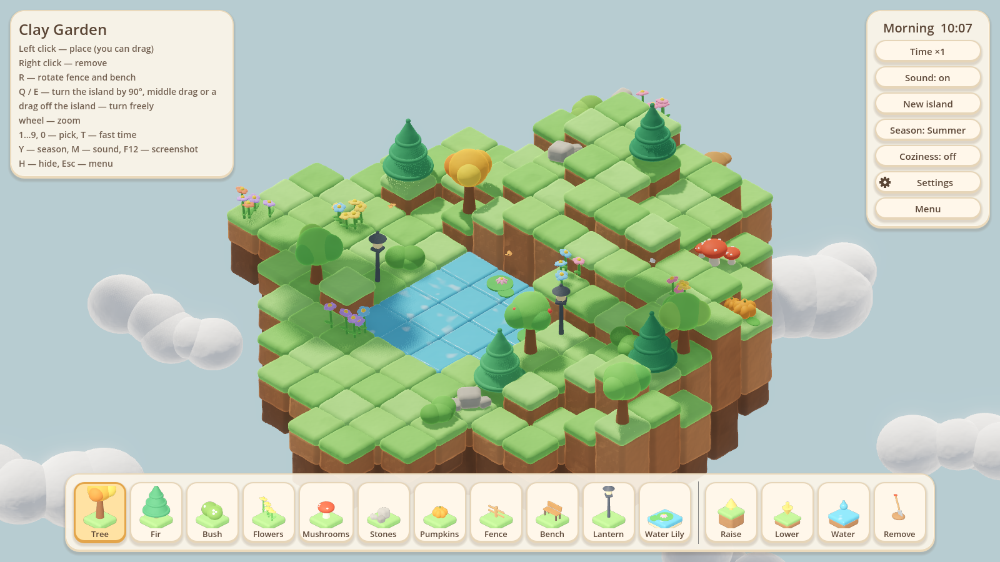
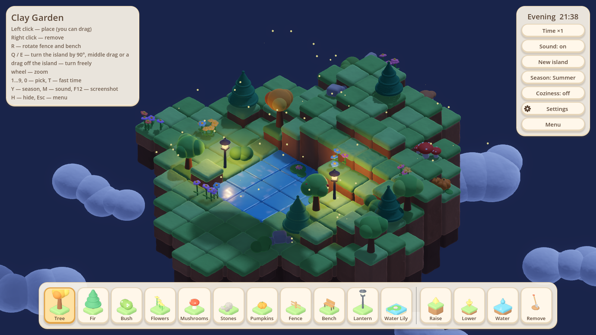
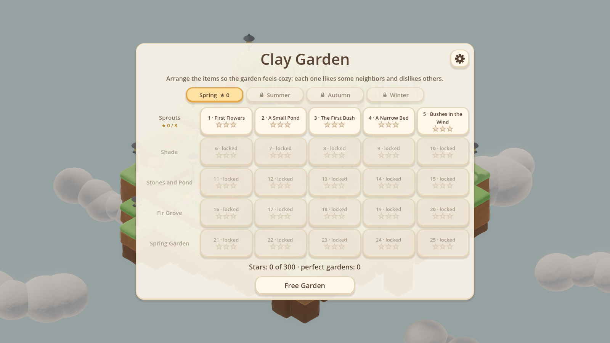
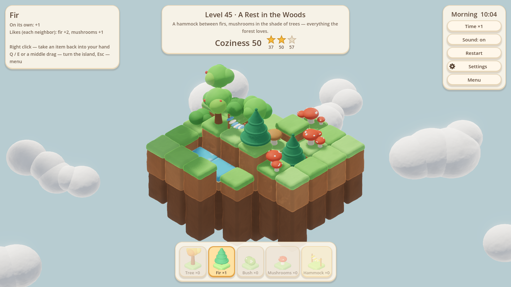
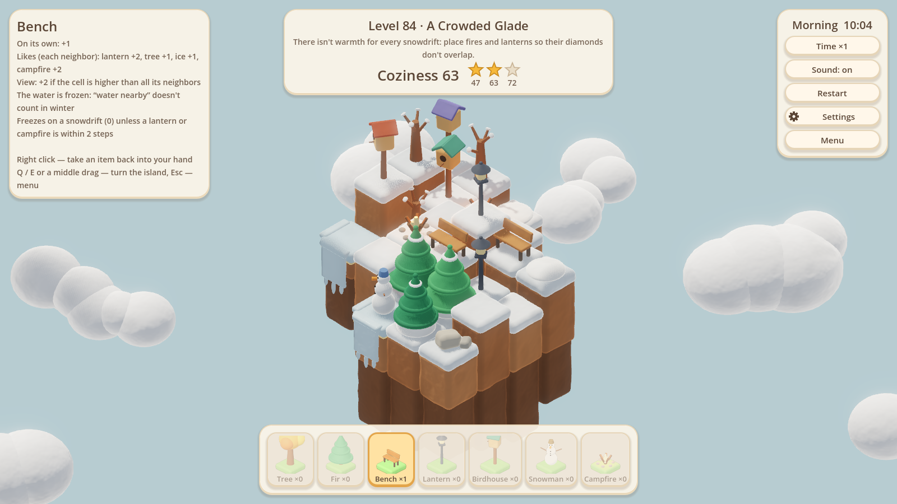
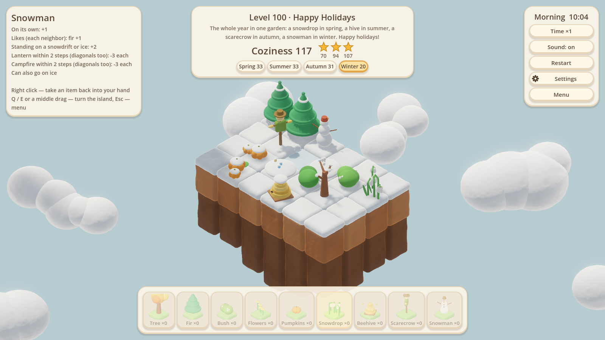
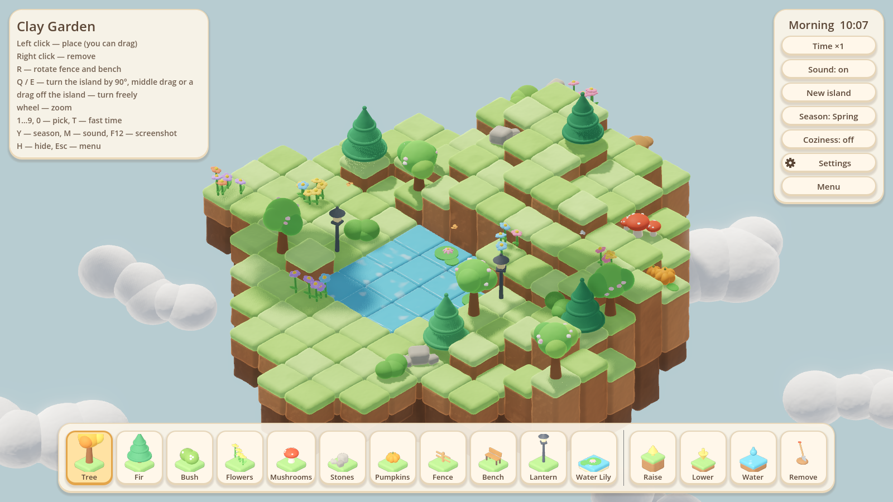
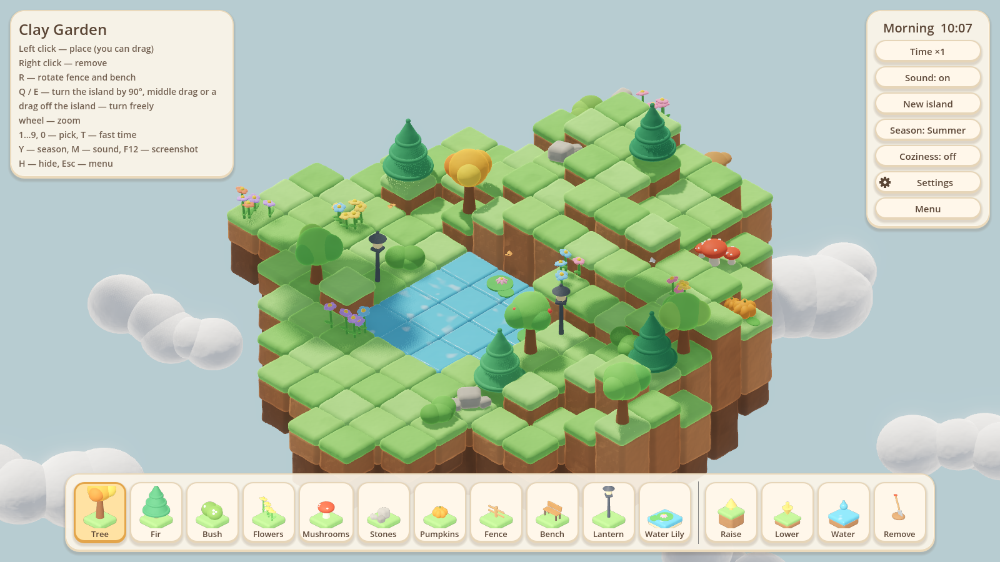
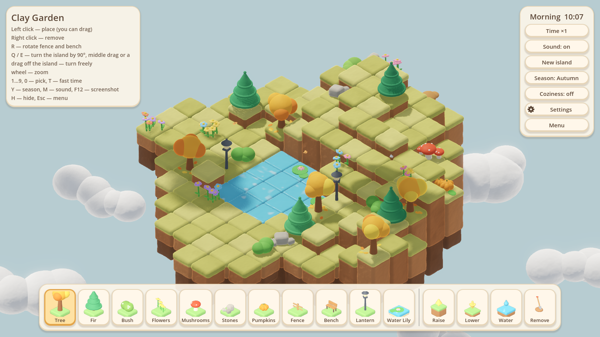
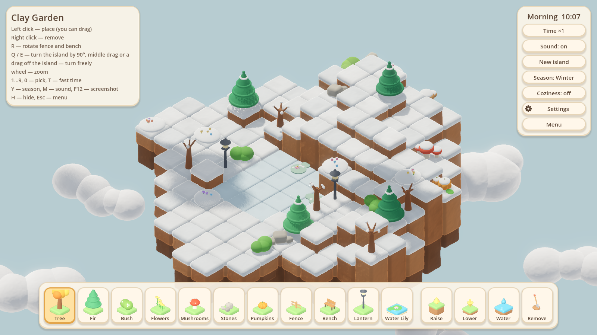

# Clay Garden

A cozy isometric game made with Godot 4.7: floating islands of clay blocks where you arrange trees, flowers,
lanterns and everything else. Two modes: a **coziness campaign — 100 levels across four seasons** — and a **free
garden** with no goals, where you choose the season yourself. English and Russian.
The plan, the decisions and how each was defended before two critics are in `docs/defense/`.




## Run on PC

You need **Godot 4.7.2** (the standard build, not .NET): <https://godotengine.org/download/archive/4.7.2-stable/>.
The game is entirely code and data — there are no models, sounds or images to download.

- **From the editor:** open `project.godot` in Godot 4.7.2 → F5.
- **From PowerShell:** `.\run.ps1` looks for Godot in `$env:GODOT`, then in `PATH`:

  ```powershell
  $env:GODOT = "C:\Tools\Godot\Godot_v4.7.2-stable_win64.exe"
  .\run.ps1                 # normal start
  .\run.ps1 -- --fresh      # new island, the save is left untouched
  .\run.ps1 -- --touch      # touch (phone) layout on PC
  ```

Saves on PC: `%APPDATA%\Godot\app_userdata\Пластилиновый сад\` (garden, progress, settings). The folder keeps its
original name on purpose — see [App name and save folder](#app-name-and-save-folder).

## Build the APK (Android)

The debug APK is built from the command line, without Android Studio or Gradle.

1. **Godot 4.7.2 export templates** — in the editor: *Editor → Manage Export Templates → Download and Install*
   (or unpack `Godot_v4.7.2-stable_export_templates.tpz` into `%APPDATA%\Godot\export_templates\4.7.2.stable\`).
2. **JDK 17** (for example, Eclipse Temurin 17).
3. **Android SDK** — the command-line tools are enough: <https://developer.android.com/studio#command-line-tools-only>.
   Install the packages (`sdkmanager` will show licenses — accept only the one you need, `android-sdk-license`):

   ```powershell
   sdkmanager --sdk_root=C:\Android\sdk "platform-tools" "build-tools;35.0.1" "platforms;android-35"
   ```

4. **Paths in the editor:** *Editor → Editor Settings → Export → Android* — `Java SDK Path` (the JDK 17 folder) and
   `Android SDK Path`. Godot creates the debug key (`debug.keystore`) on the first export.
5. **Build** (the "Android" preset is already in `export_presets.cfg`: arm64, landscape, icons, the vibration
   permission; development folders are excluded):

   ```powershell
   & "C:\Tools\Godot\Godot_v4.7.2-stable_win64_console.exe" --headless --path . --export-debug "Android" build/android/clay-garden-debug.apk
   ```

6. **Install on a phone:** enable USB debugging, connect it and run
   `adb install -r build/android/clay-garden-debug.apk` (`adb` is in `platform-tools`).
7. **Check against Google Play requirements** (Python 3, no third-party packages; the SDK and JDK are taken from
   `ANDROID_HOME` and `JAVA_HOME`):

   ```powershell
   py -X utf8 tools/check_play.py --apk build/android/clay-garden-debug.apk --project . --store store
   py -X utf8 tools/test_check_play.py build/android/clay-garden-debug.apk .   # does the check catch violations
   ```

   In `debug` mode the debug signature, `debuggable` and the temporary package name `com.example.claygarden` are
   marked "RELEASE"; with `--mode release` they are errors. Google Play also needs a real package name, a release key
   and an AAB built with Gradle (NDK + CMake) — not done yet.

The icon is a render of the game's own models (`tools/make_icon.gd`, run with a window, not headless): `icon/icon.png`
and the Android adaptive layers, including the monochrome one for themed icons. The phone uses the Mobile renderer.

Store listing: `py -X utf8 tools/store_shots.py` (console Godot in `$env:GODOT_CONSOLE`) takes 5 shots per language
(1920×1080, phone layout) into `store/<lang>/screenshots/`, plus the feature graphic `store/feature-graphic.png`
(1024×500), the icon `store/icon-512.png` and a thumbnail sheet `shots/store_contact.png` for review by eye.
The README screenshots (desktop layout, English) are retaken with `py -X utf8 tools/readme_shots.py`.
The game version is `config/version` in `project.godot` (the export preset takes it from there); the About screen
(in Settings) shows it together with the Godot license, third-party components and Android libraries.
Its Android block (`ui.gd::ANDROID_LIBS`) must match what the APK ships: `py -X utf8 tools/check_notices.py` reads
the APK's classes and native libraries and fails on a missing or an extra notice — rerun it after any template change.

### App name and save folder

The default app name is **Clay Garden** (`config/name`); every system language sees it except those listed in
`config/name_localized` (currently `ru` → «Пластилиновый сад»). When adding a game language, add it there too.
The PC save folder does not depend on the name: `config/custom_user_dir_name` pins the original path
`%APPDATA%\Godot\app_userdata\Пластилиновый сад`, so renaming the app does not "lose" existing gardens and progress.

## The goal: coziness

Every item gives **1 point** on its own, plus points for **neighbors on its four sides** (unless stated otherwise):

| Item | Likes | Dislikes |
|---|---|---|
| Tree | bush +2, flowers +1 | tree −1 (except in winter: bare trees), fir −1 |
| Fir | fir +2, mushrooms +1 | |
| Bush | tree +1, fence +1, flowers +1 | |
| Flowers | water +2, flowers +1, bench +1 | 0 on a dry cell during a drought |
| Mushrooms | fir +2, tree +2 | lantern −2 |
| Stones | water +2, stones +1, ice +1 | |
| Pumpkins | fence +2, pumpkins +1, scarecrow within 2 steps +1; tree +1 during falling leaves | tree −1 |
| Fence | fence +1, pumpkins +1, bush +1; from level 54 a row of 3+ gives each +1 | |
| Bench | water +2, lantern +2, campfire +2, flowers +1, tree +1, ice +1; **+2 for the view** | beehive −2 |
| Lantern | bench +2, fence +1; warms snowdrifts within 2 steps | lantern −2 |
| Water Lily (on water) | flowers +2, water lily +1, stones +1 | |
| Snowdrop (spring) | bush +2, water +1, stones +1 | tree −1 |
| Birdhouse (spring) | tree +2, bush +1 | birdhouse −2, scarecrow within 2 steps −2 |
| Beehive (summer) | flowers within 2 steps (diagonals too) +1 | |
| Hammock (summer) | +5 between two trees or firs, water +1 | |
| Scarecrow (autumn) | no points of its own — helps pumpkins, scares birds | |
| Haystack (autumn) | pumpkins and fence nearby +2, but no more than two | |
| Snowman (winter) | on a snowdrift or ice +2, fir +1; can stand on ice | lantern or campfire within 2 steps −3 |
| Campfire (winter) | bench nearby +2; warms snowdrifts within 2 steps | |
| Feeder (winter) | fir +2, tree +1, birdhouse +1 | campfire −2 |

A level gives you an island and a set of items "in hand". Place them all; stars are awarded for the coziness you
reach. Right-click returns an item to your hand; you can rearrange as much as you like, and you can't lose.
Hovering shows how much an item would give on that cell and what its neighbors get, and invisible reasons are
spelled out in words ("drought: 0", "cold: 0", "row of 4", the warmth diamond and the beehive radius).




## Campaign: 100 levels, 4 seasons

Spring 1–25, summer 26–50, autumn 51–75, winter 76–100; each season has 5 chapters of 5 levels. Difficulty follows
an S-curve (`scripts/campaign.gd`); items and mechanics are introduced gradually, with a banner and a rules card the
first time.

- **Spring:** snowdrop, birdhouse, spring palette.
- **Summer:** beehive (radius), hammock (between trees), drought on some levels.
- **Autumn:** scarecrow, haystack, rows of fences, falling leaves (levels 61–75: pumpkins like trees).
- **Winter:** water turns to ice (a skating rink), bare trees, snowdrifts (an item on a snowdrift without warmth
  freezes), snowman, campfire, feeder. The finale is **"All Year Round"** (96–100): one arrangement is scored by all
  four seasons and coziness is the sum; the "Spring · Summer · Autumn · Winter" row shows each season's share, and a
  tap or Tab shows the garden in that season.




**Stars** (`scripts/stars.gd`): ★ 60% of the ideal, ★★ 80%, ★★★ 92%; the **"Perfect" crown** is for matching the
solver's ideal. **Unlocking** (`Progress.open_chapters`): levels open in chapters of five. A chapter opens when the
previous one has collected **8 of its 15 stars** (`NEED_PER_FIVE`): every level at ★ and three better, or ★★ on four
levels with one skipped. Only Spring is open at first; a season opens with its first chapter, and a locked season tab
says what opens it. The open chapter shows "★ 5 / 8" under its name, and the result window says when a new chapter or
season opens. A chapter that already has progress stays open (nothing open gets locked by an update). Progress is in `user://progress.json`; the play log used to calibrate difficulty is `user://playlog.json`.

## Free garden

- Every unlocked item and terrain sculpting: raise, lower, water, remove. Seasonal items appear in the palette after
  you meet them in the campaign.
- **Garden season** — the corner button or Y: spring and summer right away, autumn and winter once you reach them in
  the campaign. The garden changes in a wave from the center; seasonal items out of season change shape (a summer
  snowman is a puddle with a carrot, in winter the beehive is under snow, the hammock is rolled up, flowers sleep
  under the snow).
- **Coziness** — an optional counter (off by default): one number by the rules of the chosen season, no thresholds.
- Day and night (6 minutes per day, T — ×30): at night the lanterns light up and fireflies come out.
- Autosave to `user://garden.json` (`%APPDATA%\Godot\app_userdata\Пластилиновый сад\`).

| Spring | Summer |
|---|---|
|  |  |
| **Autumn** | **Winter** |
|  |  |

Everywhere: wind sways the trees, items land with a clay "squash" and crumbs, and sounds are synthesized in code.
Everything is procedural: not a single texture, model or sound file.

## Settings

The gear in the main menu or "Settings" in the corner panel (one click from the garden or a level). One page:

- **Sound:** master volume, music, effects — three buses (`Master` ← `Music`, `Effects`), applied immediately.
  The music is a quiet generative music box: pentatonic, a random walk with pauses, no loop; quieter on levels.
  Birds and crickets are effects. "Sound: on/off" in the corner and M are a quick "quiet" that keeps the volumes.
- **Language:** a carousel `◀ flag Name ▶` with flags of all languages below it; switching is instant, no restart.
- **Reset progress…** — a window listing what will be lost (stars, crowns) and what stays (garden, language,
  sound); the reset button must be held for 3 seconds (a bar fills up; release early and it drains). Space/Enter can
  hold it too. A copy of the previous progress is kept in `progress.bak.json`. If the garden's season is locked after
  a reset, the garden switches to summer on entry — the plantings themselves are untouched.
- **About** — game name and version, "Made with Godot Engine", the Godot license; third-party components, Android
  libraries and full license texts behind a button.

Language and volumes are stored in `user://settings.json`.

## Languages

English and Russian; switched in Settings, the choice is stored in `user://settings.json`. On the first start a new
player picks a language on a separate screen (the system language is suggested; English is the fallback). On PC,
players of the earlier Russian-only version who already have a garden or progress stay in Russian.

**How to add a language.** Copy `lang/en.json` to `lang/<code>.json` (for example, `de.json`), translate the values
and `_meta.name` (the language's own name: "Deutsch"), and optionally `_meta.flag`: an SVG flag (simple shapes, no
text, up to 4 KB; without it Settings shows a badge with the language code). No code changes are needed — languages
are discovered automatically. A translation can also be dropped into
`%APPDATA%\Godot\app_userdata\Пластилиновый сад\lang\` without rebuilding the game.

- Keys are semantic (`ui.menu.total`, `card.near`, `item.tree`, `level.<id>.name`); substitutions are named —
  `{n}`, `{item}` — so the word order in a translation is free. A missing key falls back to English.
- Rules cards are assembled from whole phrases (`card.*`); names inside them are `noun.<id>`, titles are `item.<id>`:
  keep these words the same in level hints.
- If a text talks about keys or the mouse, the phone needs a variant with the `_touch` suffix
  (`level.four_times.hint_touch`, `ui.result.need_first_touch`): it is used with touch controls, otherwise the normal
  one. `test_touch` checks that no level hint on the phone mentions Tab, right-click, the mouse wheel and so on.
- Plural forms are not supported: phrases are built so that the number doesn't change the word.
- The game font covers Latin and Cyrillic; Chinese, Japanese and Arabic would need their own font.
- Checking a translation: `tests/test_i18n.gd` (all keys and substitutions present, no Cyrillic in English, a walk
  through the whole interface) and the pseudo-language `.\run.ps1 -- --lang=xx`: every string is wrapped in `[!…!]`,
  so anything untranslated stands out.
- Level names and hints live only in `lang/*.json` (`level.<id>.name`, `level.<id>.hint`); English is the source text.

## Controls

| | |
|---|---|
| Left click (can drag) | place / apply a tool |
| Right click | remove an item (on a level — back to hand) |
| R | rotate fence, bench, hammock |
| Q / E | turn the island to the next fixed position (45° + k·90°; from a free angle — the next one in that direction, skipping one closer than 10°) |
| Middle drag, or a left drag that starts off the island | turn the island freely around its center |
| Mouse wheel | zoom (the closest zoom keeps the whole island on screen) |
| 1…9, 0 | pick an item |
| Y | free garden season |
| Tab | "All Year Round": next season |
| T / M / H / F12 | speed up time / quiet / hint / screenshot |
| Esc | close a window (settings, result) or go to the menu |

The camera always looks at the island's center; there is no panning. All windows (the result, settings, About, the
reset window, and on a phone "≡" and "?") go through one stack, `scripts/sheets.gd`: a dimmed full-screen layer that
closes on a tap outside its panel (except the result and the reset window), and Back / Esc close the top one.

### On a touch screen

Turns on by itself on Android/iOS (on PC — `--touch`: the mouse acts as a finger, the interface is phone-sized).

| | |
|---|---|
| tap a cell (level) | **try it**: a ghost, how much the item gives and what its neighbors get; **tap the same cell again** to place |
| tap a cell (garden) | place / apply the tool right away; a tap on an item selects it |
| tap an item, then the trash | back to hand (level) / remove (garden); without a selection the trash says what to do |
| hold a finger on an item | the same as the trash; a ring shows how long to hold |
| drag with one finger | turn the island around its center by any angle (with a little inertia; near a fixed position it eases into it) |
| pinch | zoom |
| the column at the bottom right | rotate the item (fence, bench, hammock; its slot stays empty otherwise), trash, **undo** (10 steps; Ctrl+Z on PC) |
| "Back" (Android) | close a window; in a level or the garden — open "≡" (an edge swipe is Back, so it never leaves a level); in the menu a second press exits |

**Phone layout** is a separate interface subclass, `scripts/ui_phone.gd` (the desktop one is unchanged), based on
the designer agent's mockups (the decisions are in `docs/defense/step10-touch.md`, the stage 14 polish in
`step14-phone-polish.md`) for a Pixel 10 Pro XL in landscape: a logical canvas of 1333×600, buttons at least 56 px
(≈ 6.5 mm), one gap of 16 px to every screen edge and between neighbors (inside the system safe area: the camera
hole and the rounded corners).

- "≡" at the top left opens a full-screen window of rare things: time, new island / restart (double press), coziness,
  settings, menu.
- The top bar: on a level — the name, coziness and stars with thresholds (plus the "All Year Round" season row); in
  the garden — season and time (tap for the next season; coziness appears there too when it's on). "?" at the top
  right — a full-screen gesture cheat sheet.
- The rules card on the left (level): the header with the item name collapses it; the level hint and the rules; long
  ones scroll with a finger.
- At the bottom: the item dock (icons, "×N" on a level; scrolls), a permanent terrain group in the garden; the action
  column at the right edge. Nothing appears over the play area.
- The island is drawn at the center of the free area (between the card, the column, the top bar and the dock); it never
  moves when the card collapses or a window opens. The level result opens a second after the last placement, centered
  over a light dim.

The first try, the first placement and entering the garden show a short tip. The app saves everything when it goes
to the background.

## Under the hood

- `shaders/clay.gdshader`: clay (noise-based bump without textures, dents, a light rim).
- `scripts/clay.gd`: rounded "squished" blocks and a material cache.
- `scripts/terrain.gd`: the island of columns, level maps, seasonal palettes, ice, snowdrifts, drought; water finds its
  level (a pond is never higher than the land around it) and falls as a clay waterfall from the island's edge.
- `scripts/items.gd`: the item catalog and modeling, seasonal shapes.
- `scripts/scoring.gd`: coziness rules as data (`adj`, `water`, `view`, `near`, `between`, `line`, `cap`, `thirst`,
  `ice`, `on`, cold), conditional rules by campaign flags, score hints, the solver.
- `scripts/board.gd`: the scoring board and the single placement rule; factories for a level, "All Year Round" and
  the free garden.
- `scripts/campaign.gd`: seasons, chapters, item unlocks, campaign flags, "All Year Round", free garden seasons.
- `scripts/levels.gd` + `data/levels.json`: 100 levels; `scripts/progress.gd`: progress and chapter unlocks.
- `scripts/main.gd`: modes, camera, input, day and night, wildlife, saving, the season-change wave.
- `scripts/ui.gd`: the season menu, the palette with live 3D thumbnails, the coziness bar, results, language choice,
  settings, the reset window and About; icons (gear, arrows) are SVG in code.
- `scripts/sfx.gd`: sound synthesis and audio buses; `scripts/music.gd`: generative music.
- `scripts/i18n.gd` + `lang/*.json`: languages (dictionaries, English fallback, pseudo-language).

Debug options (after `--`): `--level=N`, `--sandbox`, `--autosolve` (`--explain` — label each item's points;
`--yearview=autumn` — an "All Year Round" season; `--midplay` — take the most valuable item back and try it),
`--fresh`, `--nosave`, `--newplayer`, `--lang=en` (`xx` — pseudo-language), `--langpick`, `--touch` (touch mode;
with `--resolution 1600x720` — like a phone), `--aim=x,y` (try a cell, screenshot), `--drawer` (open "≡"),
`--sheet=drawer` / `--sheet=help` (a phone window open), `--yaw=20` (the camera's yaw in degrees),
`--settings`, `--about`, `--resetbar=0.5` (the reset window with a frozen bar; nothing is reset), `--season=winter`
(the free garden's season; in the menu — that season's tab),
`--cozy`, `--seed=7`, `--time=0.9`, `--tool=bench`, `--click=x,y;x,y`, `--hover=x,y`, `--rclick=x,y`, `--nocoach`
(no tips or toasts), `--nocard` (collapse the rules card), `--noui`, `--zoom=11`, `--shot=path.png` (screenshot and
exit). `--level=N` starts any level regardless of unlocking, and a finished level is saved to your progress (which
opens its chapter) — add `--nosave` for test runs.

Tests:

```powershell
$g = "C:\Tools\Godot\Godot_v4.7.2-stable_win64_console.exe"   # console build of Godot 4.7.2
& $g --headless --path . --script res://tests/test_rules.gd      # the coziness engine against reference values
& $g --headless --path . --script res://tests/test_campaign.gd   # campaign, progress, unlocks
& $g --headless --path . --script res://tests/test_perfect.gd    # the ideal in data = what the solver finds
& $g --headless --path . --script res://tests/test_sandbox.gd    # free garden seasons, the wave, saving
& $g --headless --path . --script res://tests/test_i18n.gd       # languages: dictionaries, cards, the whole interface in English
& $g --headless --path . --script res://tests/test_settings.gd   # settings: buses, carousel, hold-to-reset, About, player files intact
& $g --headless --path . --script res://tests/test_touch.gd      # touch: try-then-place, gestures, undo, Back, phone layout
& $g --headless --path . --script res://tests/test_water.gd      # water: never above land, garden edits and undo, waterfalls
py -X utf8 tools/check_english.py                                  # everything is English; Russian only in the localization package
```

## License

© 2026 Maksim Aksenov. MIT License — see [LICENSE](LICENSE). The Godot engine is MIT too; its notices and the
notices of third-party components are in the game: Settings → About. Nothing else is borrowed: models, music and
sounds are made by the game's code — see the [IP review](docs/legal/ip-review.md).
